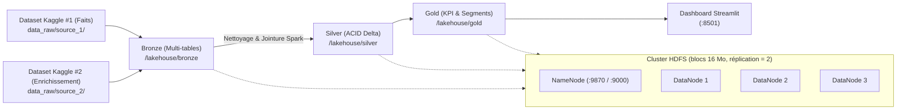
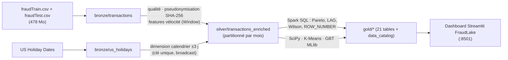
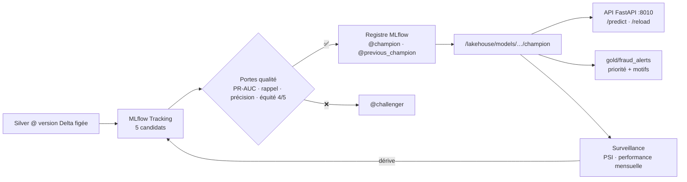

# TP Big Data Lakehouse — HDFS (3 DataNodes) + PySpark + Delta Lake + Streamlit

> **🛡️ FraudLake — Détection de transactions bancaires frauduleuses**
>
> | | |
> |---|---|
> | **Réalisé par** | **Yan-Mol LANGWANA** et **Rabab KOULI** |
> | **Cours** | Architecture des systèmes Big Data |
> | **Professeur** | Antoine GREA |
> | **Rapport** | [`rapport/rapport.pdf`](rapport/rapport.pdf) |

Environnement pédagogique complet compatible nativement **`linux/amd64` (PC x86_64 / WSL2)** et **`linux/arm64` (Apple Silicon M1–M4 / Linux ARM64)** sur **Ubuntu 26.04 LTS**, reposant sur un **cluster HDFS 3.5 réel distribué (1 NameNode + 3 DataNodes)** avec blocs réduits à **16 Mo** et détection de panne abaissée à **~50 secondes**, couplé à une image mutualisée légère (`ubuntu:26.04` + **Python 3.15** via `uv` + OpenJDK 21 + JARs Delta pré-embarqués) pour **PySpark 4.2**, **Delta Lake 4.4**, **JupyterLab 4.6** et **Streamlit**.

Chaque étudiant / groupe **choisit librement sa thématique métier et combine un dataset multi-tables ou plusieurs datasets publics complémentaires sur Kaggle** (croisés par jointure distribuée) pour construire de bout en bout une architecture **Data Lakehouse Médaillon (Bronze → Silver → Gold → Dashboard)**.



---

## 🛡️ Notre projet : FraudLake — Détection de transactions frauduleuses

*Projet de Yan-Mol LANGWANA et Rabab KOULI — encadré par Antoine GREA.*

| | |
|---|---|
| **Problématique** | Quels signaux distinguent une transaction bancaire frauduleuse, et comment prioriser les alertes pour réduire les pertes sans saturer l'équipe anti-fraude ? |
| **Source 1 — faits** | [`kartik2112/fraud-detection`](https://www.kaggle.com/datasets/kartik2112/fraud-detection) : 1 852 394 transactions CB (2019 – 2020), 0,52 % de fraudes — `fraudTrain.csv` (335 Mo, 21 blocs HDFS) + `fraudTest.csv` (143 Mo, 9 blocs) |
| **Source 2 — enrichissement** | [`donnetew/us-holiday-dates-2004-2021`](https://www.kaggle.com/datasets/donnetew/us-holiday-dates-2004-2021) : calendrier des jours fériés US |
| **Jointure** | temporelle : date de transaction ⟷ jour férié le plus proche (± 3 jours), `BroadcastHashJoin` sur dimension à clé unique |



| Jour | Notebook | Points forts |
|---|---|---|
| J1 | `J1_HDFS_Ingestion_Bronze` | upload HDFS idempotent, cartographie des blocs par DataNode, état du cluster pendant le crash-test, alignement 1 partition = 1 bloc, schéma explicite |
| J2 | `J2_Spark_Delta_Silver` | vides masqués, incohérence `unix_time` (+7 ans), RGPD, 20 features (Haversine, vélocité 24 h sans fuite), preuve chiffrée de l'explosion N-à-M évitée, MERGE *chargebacks* → Time Travel → `RESTORE` |
| J3 | `J3_Analytics_SQL_Gold` | `GROUPING SETS`, Pareto des pertes, moyenne glissante 7 j, `LAG`, IC de Wilson par État, échantillon stratifié pondéré, `OPTIMIZE ZORDER BY`, catalogue `data_catalog` |
| J4 | `J4_Stats_Segmentation_Dashboard` | 4 tests avec tailles d'effet, K-Means des porteurs (silhouette), **modèle GBT** évalué sur période future (PR-AUC), courbe de seuil coût/bénéfice |
| J5 | `J5_MLOps_Industrialisation` | **MLOps** : 5 candidats suivis dans MLflow, données versionnées (Delta Time Travel), portes qualité + équité (règle des 4/5), registre `@champion`, déploiement API, file d'alertes expliquée, surveillance PSI + test de stress |

### ⚙️ Volet MLOps



| Composant | Emplacement | Rôle |
|---|---|---|
| Package partagé | `fraudlake/` | features, motifs d'alerte, seuils, PSI : **une seule définition** pour l'entraînement, le batch et l'API |
| API de scoring | `serving/` · service `fraud-api` (:8010) | FastAPI : `/predict`, `/predict/batch`, `/health`, `/stats`, `/reload` (bascule à chaud du champion) |
| Suivi & registre | service `mlflow` (:5050) | expériences, métriques, artefacts, versions et alias du modèle |
| Tests & CI | `tests/` · `.github/workflows/ci.yml` | 33 tests unitaires (features, motifs, PSI, contrat d'API) + `ruff` |
| Fiche modèle | `mlops/MODEL_CARD.md` | générée à chaque exécution de J5 |

Résultats obtenus sur le cluster (exécution complète J1 → J5) : champion `gbt_v2` avec **PR-AUC 0,926** sur la période de test,
rappel 86 %, précision 89 %, ratio d'équité 0,87 ; alertes « critiques » confirmées à **97,1 %** ; seule une vraie dérive
(décembre, achats de Noël) déclenche un ré-entraînement.

> ⚠️ **Ressources Docker** : prévoir au moins 8 Go de RAM et 15 Go de disque libres pour Docker Desktop (Settings › Resources).
> Sur macOS, le port 5000 est réservé par AirPlay : MLflow est donc exposé sur **5050** et l'API sur **8010**
> (modifiables via les variables `MLFLOW_PORT` et `API_PORT`).

```bash
task test:unit     # 33 tests unitaires        task api:smoke     # santé + prédiction d'exemple
task mlops:retrain # ré-entraîner / promouvoir  task mlops:ui      # MLflow :5050 · API :8010/docs
```

```bash
task up && task data:fraud      # cluster + téléchargement des 2 datasets
task test:notebooks             # exécute J1 → J5 et valide les couches Delta
open http://localhost:8501      # dashboard FraudLake
```

### 📊 Dashboard FraudLake (:8501)

Interface en 12 pages avec navigation latérale, lisant uniquement la couche Gold : vue d'ensemble, **recherche de transactions** (console type backoffice : recherche, filtres, fiche détaillée), catégories (Pareto), temporalité,
géographie (intervalles de Wilson), segments clients, modèle de scoring (simulateur de seuil et gain net), **scoring temps réel**
(appel de l'API du champion : jauge, verdict, motifs), tests statistiques, file d'alertes (flux de détection Sankey, export CSV),
MLOps (registre, dérive, équité) et gouvernance des données. Lien direct vers une page : `http://localhost:8501/?page=live`.
Thème : `app/.streamlit/config.toml`.

L'API se répare seule si sa JVM Spark est tuée (manque de mémoire) : `/health` passe en `degraded`, et l'appel suivant relance Spark,
recharge le champion et rejoue la requête.

> Les notebooks vierges d'origine sont conservés dans `notebooks/example/_template_vierge/`.

---

## Critères de choix de vos Datasets Kaggle (Mono ou Multi-Sources avec Jointure)

Pour tirer pleinement parti de l'infrastructure distribuée, des jointures Spark (Jour 2) et des exercices statistiques (Jours 3 & 4), choisissez sur [Kaggle Datasets](https://www.kaggle.com/datasets) **soit un dataset relationnel multi-tables, soit 2 (ou plusieurs) datasets complémentaires** respectant ces critères :

1. **Volumétrie cumulée : ~50 Mo à 500 Mo** (avec au moins un fichier dépassant **20 à 32 Mo** afin d'observer physiquement le découpage multi-blocs de **16 Mo** sur HDFS au Jour 1).
2. **Axe de jointure clair entre tables / datasets** :
   - **Jointure temporelle** (`date`, `jour + heure`, `yyyy-MM`) — *ex. courses de mobilité / vols aériens / consommation électrique × relevés météo horaires ou calendrier des jours fériés*.
   - **Jointure géographique** (`code pays ISO`, `ville / État`, `code postal`, `aéroport IATA`) — *ex. commandes e-commerce / immobilier / santé × indicateurs socio-démographiques ou référentiel géographique*.
   - **Jointure par identifiant ou nomenclature métier** (`product_id`, `category`, `station_id`, `carrier_code`).
3. **Richesse des attributs** :
   - Au moins **une colonne temporelle** (dates / timestamps d'événements) pour les analyses de séries et de croissance (`LAG`).
   - Des **variables quantitatives continues** (montants, durées, distances, consommations, retards, températures...) permettant d'étudier l'asymétrie (médiane vs moyenne, IQR) et de tester statistiquement l'effet croisé entre vos datasets au Jour 4.
   - Des **dimensions catégorielles ou géographiques** permettant de pratiquer le *Broadcast Hash Join* (et/ou *SortMergeJoin*) sans explosion N-à-M.

---

## Arborescence du dépôt

```text
.
├── .devcontainer/
│   └── devcontainer.json       # Connexion VS Code directe au conteneur spark-jupyter
├── .vscode/
│   ├── extensions.json         # Extensions recommandées (Python, Jupyter, Ruff, Docker, Task)
│   ├── launch.json             # Débogage PySpark & prévisualisation Streamlit (:8502)
│   ├── settings.json           # Kernel Python/Jupyter pré-configuré, Ruff & propreté éditeur
│   └── tasks.json              # Actions VS Code en 1 clic (Démarrer, Télécharger Kaggle, Crash-test...)
├── docker-compose.yml          # Cluster HDFS (1 NN + 3 DN) + JupyterLab + Streamlit
├── Taskfile.yml                # Orchestration go-task (démarrage, crash-test, tests J1..J4)
├── mise.toml                   # Gestionnaire d'outils (go-task, uv, python 3.15)
├── pyproject.toml              # Dépendances Python compatibles uv (Python >= 3.15)
├── config/
│   ├── core-site.xml           # Point d'entrée RPC hdfs://namenode:9000
│   ├── hdfs-site.xml           # Blocs 16 Mo, réplication=2, détection panne ~50s
│   └── spark-defaults.conf     # Pré-configuration automatique HDFS + Delta Lake
├── docker/
│   ├── hadoop/
│   │   └── Dockerfile          # Image HDFS 3.5.0 Ubuntu 26.04 native multi-arch (amd64 & arm64)
│   └── workspace/
│       ├── Dockerfile          # Image Ubuntu 26.04 multi-arch (Python 3.15 + uv + OpenJDK 21 + Delta 4.4)
│       └── requirements.txt    # Dépendances Python 3.15 pour le workspace
├── data_raw/                   # Dépôt local de vos fichiers Kaggle avant ingestion HDFS
├── notebooks/                  # Notebooks TP pas-à-pas agnostiques (Jours 1 à 4)
│   ├── J1_HDFS_Ingestion_Bronze.ipynb
│   ├── J2_Spark_Delta_Silver.ipynb
│   ├── J3_Analytics_SQL_Gold.ipynb
│   └── J4_Stats_Segmentation_Dashboard.ipynb
└── app/
    └── dashboard.py            # Squelette Streamlit connecté à /lakehouse/gold/
```

---

## Démarrage rapide

### Avec `mise` et `go-task` (recommandé)

```bash
# 1. Installer automatiquement task (go-task) et uv si absents
mise trust && mise install

# 2. Construire l'image et démarrer tout le cluster (attend la disponibilité des 3 DataNodes)
task up

# 3. Télécharger un ou plusieurs datasets Kaggle dans data_raw/<nom-dataset>/
task data:download DATASET="auteur1/dataset-1,auteur2/dataset-2"
```

### Sans `task` (commandes Docker natives)

```bash
docker compose up -d --build
```

---

## Interfaces exposées

| Service | URL | Détails |
|---|---|---|
| **HDFS NameNode UI** | http://localhost:9870 | Onglets *Datanodes* & *Utilities > Browse the file system* |
| **JupyterLab** | http://localhost:8888 | Mot de passe / Token : `bigdata` |
| **Spark Web UI** | http://localhost:4040 | DAG, Stages & Shuffle *(actif dès qu'une `SparkSession` tourne)* |
| **Dashboard Streamlit** | http://localhost:8501 | Lecture des tables Delta de `/lakehouse/gold/` avec cache 60s |
| **MLflow** | http://localhost:5050 | Expériences, runs, artefacts et registre de modèles (projet FraudLake) |
| **API de scoring** | http://localhost:8010/docs | Documentation interactive FastAPI — `POST /predict` avec la transaction d'exemple |

---

## Travailler dans VS Code (Kernel Jupyter & Conteneur pré-configurés)

### Option A — Mode Dev Container intégré *(recommandé : auto-complétion PySpark, Ruff, Git & Kernel en 1 clic)*
1. Ouvrez ce dossier dans VS Code et installez l'extension recommandée **Dev Containers** (`ms-vscode-remote.remote-containers`).
2. Cliquez sur **Reopen in Container** (ou `Ctrl+Shift+P` → `Dev Containers: Reopen in Container`).
3. VS Code vous connecte directement dans `spark-jupyter` (`/workspace`) avec le kernel **`Python 3.15 (PySpark 4.2 + Delta Lake 4.4)`**, Pylance, Ruff, `git`, `jq` et `pytest` prêts à l'emploi.

### Option B — Mode Léger depuis l'hôte *(idéal pour les PC portables à 8 Go de RAM)*
1. Lancez `task up`.
2. Ouvrez un notebook dans `notebooks/`, cliquez sur **Select Kernel** → **Existing Jupyter Server...** → `http://localhost:8888/?token=bigdata`.

---

## Programme des Notebooks (`notebooks/`)

1. **`J1_HDFS_Ingestion_Bronze.ipynb` — Cadrage du sujet, HDFS & Tolérance aux pannes**
   - Sélection et téléchargement de votre dataset Kaggle via `kagglehub`.
   - Téléversement sur HDFS, inspection du découpage en **blocs de 16 Mo** et de la **Data Locality** (`1 bloc = 1 partition Spark`).
   - **Crash-test en direct** : arrêt de `datanode2`, détection en ~50s, auto-réplication sur le 3e DataNode et lecture sans interruption.
   - Ingestion vers la couche **Bronze** (`/lakehouse/bronze/`) au format Delta Lake avec métadonnées de traçabilité.
2. **`J2_Spark_Delta_Silver.ipynb` — Nettoyage, Jointures distribuées & Transactions ACID**
   - Profilage qualité, typage fort, dédoublonnage et création d'indicateurs métier propres à votre sujet.
   - Optimisation des jointures (**Broadcast Hash Join** vs SortMergeJoin) et prévention des produits cartésiens N-M.
   - Garanties ACID Delta Lake sur `/lakehouse/silver/` : `_delta_log`, **Schema Enforcement**, **Upsert (`MERGE INTO`)** et **Time Travel (`VERSION AS OF`)**.
3. **`J3_Analytics_SQL_Gold.ipynb` — Spark SQL avancé, Rigueur statistique & Couche Gold**
   - Diagnostic d'asymétrie (`SKEWNESS`) : justification statistique du couple **Médiane (`PERCENTILE_APPROX`) + IQR** face à la moyenne.
   - Fonctions de fenêtrage SQL (`DENSE_RANK`, courbe cumulée de **Pareto**, `ROW_NUMBER`, évolution temporelle `LAG`).
   - Alimentation de vos tables **Gold** (`/lakehouse/gold/`) et compaction `OPTIMIZE`.
4. **`J4_Stats_Segmentation_Dashboard.ipynb` — Tests statistiques, Segmentation & Dashboard**
   - Tests d'hypothèses non-paramétriques (`scipy.stats` : **Mann-Whitney U**, **Kruskal-Wallis**, **Spearman**).
   - Segmentation / typologie non supervisée (**K-Means** avec `log1p` + `StandardScaler`) enregistrée en couche Gold.
   - Restitution décisionnelle interactive et documentée dans `app/dashboard.py` sur `http://localhost:8501`.

---

## Commandes `task` principales (`Taskfile.yml`)

```bash
task up                                  # Démarrer le cluster et attendre les 3 DataNodes + Jupyter + Streamlit
task status                              # État des conteneurs et rapport HDFS (dfsadmin -report)
task data:download DATASET="a/ds1,b/ds2" # Télécharger un ou plusieurs datasets dans data_raw/<nom>/
task hdfs:ls                             # Lister l'occupation disque des couches Bronze / Silver / Gold
task hdfs:fsck                           # Inspecter les blocs de 16 Mo et leurs DataNodes hôtes
task hdfs:crash-dn2                      # [TP Jour 1] Couper datanode2 pour observer l'auto-réparation en ~50s
task hdfs:restore-dn2                    # [TP Jour 1] Relancer datanode2
task test:docker                         # Vérifier la santé de HDFS, JupyterLab et Streamlit
task test:notebooks                      # Exécuter et valider vos 4 notebooks (J1 -> J4)
task down                                # Arrêter les conteneurs (conserve les volumes HDFS)
task clean                               # Arrêter et purger les volumes HDFS
```
